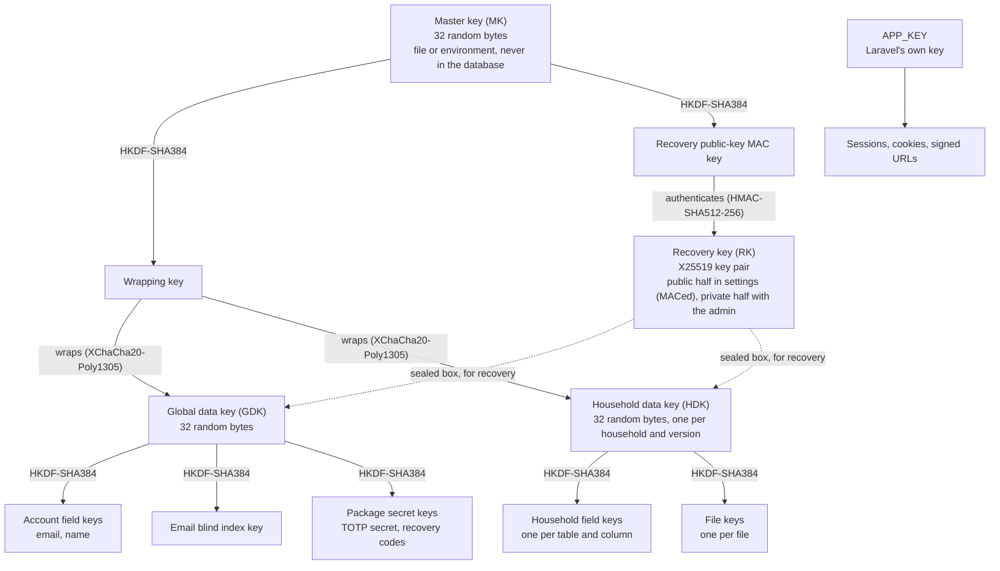
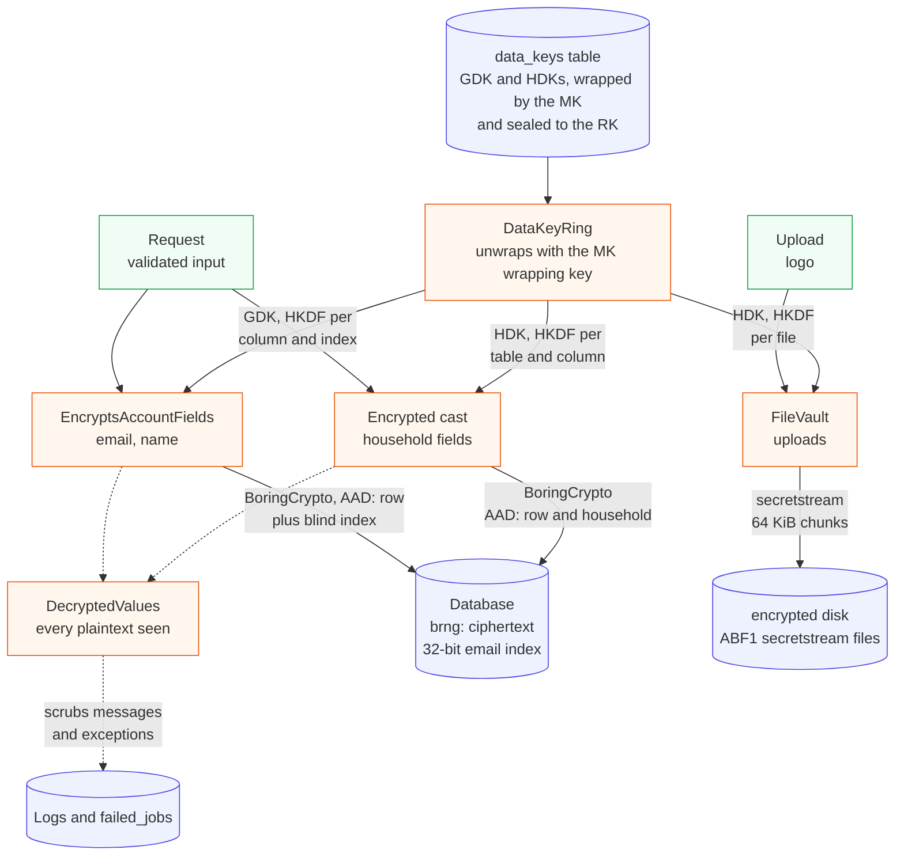
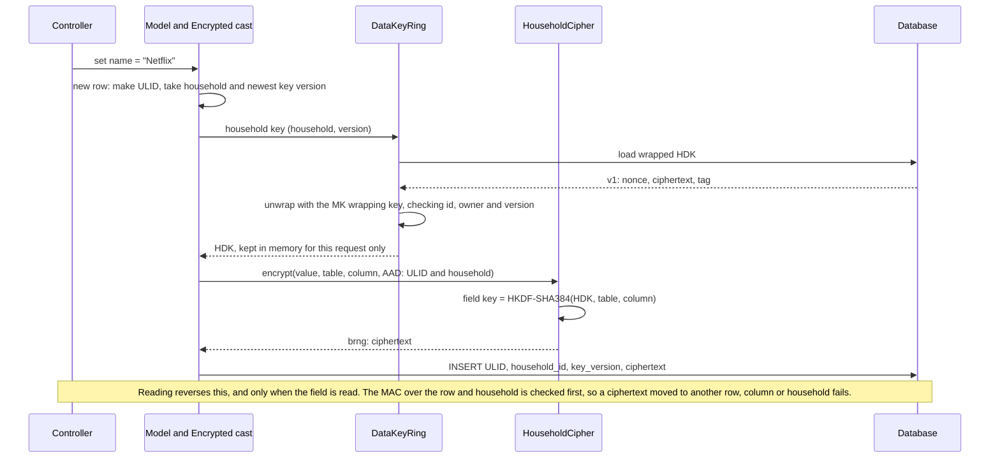

# Data security

This document covers how Abonemen protects the data it stores:

- which data is encrypted, with which keys and constructions, and where in the code that happens;
- the security argument, a composed proof that reduces the security of the whole app to published results about its primitives;
- what it does not protect against.

The [technical design](../product/technical-design.md#encryption-and-key-management) records the decisions; this document explains and justifies them, with references.

**Status:**
- **Built** (#18 to #24, epic #17): the key hierarchy, field encryption, file encryption and log redaction.
- **Designed but not built yet**, and marked *planned* below: backups (#85), key rotation and recovery commands (#140), and the setup wizard (#25).

## Contents

1. [What is protected, and from whom](#1-what-is-protected-and-from-whom)
2. [Key hierarchy](#2-key-hierarchy)
3. [Data pipeline: where each kind of data is protected](#3-data-pipeline-where-each-kind-of-data-is-protected)
4. [Constructions and parameters](#4-constructions-and-parameters)
5. [The security argument](#5-the-security-argument)
6. [Specific properties](#6-specific-properties)
7. [Lessons from recent breaks of similar systems](#7-lessons-from-recent-breaks-of-similar-systems)
8. [What this does not protect](#8-what-this-does-not-protect)
9. [Known gaps](#9-known-gaps)
10. [How it is tested](#10-how-it-is-tested)
11. [References](#11-references)

## 1. What is protected, and from whom

**Protected:**
- everything a household enters about its subscriptions and members;
- user names and email addresses;
- second-factor secrets;
- uploaded files.

Section 3 lists them field by field.

**Threats in scope:**

| Threat | Protected? |
| --- | --- |
| A stolen disk, database file or backup | Yes: it holds ciphertext, wrapped keys and 32-bit blind indexes only |
| SQL injection or another bug that reads tables | Yes, same reason |
| SQL injection or another bug that *writes* tables | Confidentiality: yes. Integrity: tampering is detected, except rolling a field back to an older value of the same field (section 8) |
| Ciphertext copied between rows, columns or households | Yes: every ciphertext is bound to its row and household |
| Someone who can read logs or failed-job records | Yes: plaintext is kept out of both (section 3.7) |
| Traffic interception | Yes: TLS only, with HSTS |
| An attacker who controls the running server and its environment | **No**: the server must be able to decrypt to work |
| A curious instance operator | **No**, same reason; stated in the privacy notice |

The last two rows are the fundamental limit of server-side encryption. It protects data *at rest* and against partial compromise, not against whoever runs the server. A zero-knowledge mode, where only the browser can decrypt, is out of scope for 1.0.

Section 5.1 turns the first five rows into a precise attacker model.

## 2. Key hierarchy

| Key | What it is | Where it lives | What it protects |
| --- | --- | --- | --- |
| Master key (MK) | 32 bytes from the operating system's CSPRNG | `ABONEMEN_MASTER_KEY_FILE` (preferred) or `ABONEMEN_MASTER_KEY`. Never in the database, the config cache, logs or backups | Through its two subkeys: wraps every data key, and authenticates the RK's public half |
| Recovery key (RK) | X25519 key pair | Public half in the `settings` table, with a MAC under the MK's MAC key; private half shown once to the admin, never stored | Every data key is also sealed to it, so it alone can restore them |
| Global data key (GDK) | 32 random bytes | `data_keys`, wrapped by the MK and sealed to the RK | Account fields, the email blind index, package secrets |
| Household data key (HDK) | 32 random bytes, one per household, versioned | `data_keys`, wrapped and sealed like the GDK | That household's fields and files |
| `APP_KEY` | Laravel's key | Environment | Sessions, cookies and signed URLs only; never stored data |

**One key, one algorithm.** Every key in the hierarchy is used by exactly one algorithm:

- **Root and data keys (MK, GDK, HDK):** these go into HKDF-SHA384 only, which derives a separate key for each use under a distinct label.
- **Leaf keys:** each is used by its one primitive only. These are the wrapping key, the MAC key, field keys, the index key and file keys.

This is the textbook key-separation rule, and it is not a formality:

- **The proofs need it.** No security proof covers one key used by two different algorithms, and the argument in section 5 relies on each key feeding one algorithm.
- **Breaks come from ignoring it.** Weak key separation is how systems built from sound primitives have been broken in practice. Threema is the example: it is built on NaCl, the same primitives as libsodium, and a cross-protocol attack came from weak key separation between its sub-protocols [PST2023]. Section 7 has more cases.

The labels are distinct by construction:
- CipherSweet's own labels start with fixed 32-byte prefixes (`DS_FENC`, `DS_BIDX`, `DS_EXT`);
- Abonemen's labels start with `abonemen:` (`abonemen:master-key:key-wrap`, `abonemen:master-key:recovery-public-key`, `abonemen:file:{ULID}`, `encrypter:{purpose}`).

The formal treatment of this kind of domain separation is Bellare, Davis and Günther [BDG2020]; section 5 uses it.

This is envelope encryption: data is encrypted with data keys, and data keys are encrypted (wrapped) with a key-encryption key that is stored apart from the data. OWASP recommends exactly this separation: keys "stored in a separate location from encrypted data", and a key-encryption key "stored separately" from the data-encryption keys it protects [OWASP-CS]. Hirose and Minematsu give a formal model of envelope encryption with generic constructions from two AEADs, the shape used here [HM2024]. Two consequences follow:

- **Rotating the master key** only rewraps a few dozen 32-byte keys; no data is re-encrypted (*planned*, #140).
- **Deleting a household** deletes its data keys first, which makes its remaining ciphertext unreadable: cryptographic erase [NIST-88] (section 6.8).

Unwrapped keys exist only in memory for one request or job (`DataKeyRing`). The objects that hold them (`MasterKey`, `DataKeyMaterial`, `RecoverySecret`) hide their bytes from `var_dump()` and `print_r()` and refuse to be serialised, so they cannot end up in a log, a cache entry or a queued job. `MasterKey` does not hand out its own bytes at all, only its two derived keys.

**Why the master key is read from the environment at runtime, not from the config:**
- Laravel's `config:cache` writes every config value to `bootstrap/cache/config.php`, and anything in `config()` is visible to whatever dumps the config.
- `MasterKeyLoader` therefore reads the variable itself, removes it from `$_SERVER`, `$_ENV` and the request, and keeps the only copy.
- The file form is preferred because environment variables leak more easily. OWASP advises against keeping keys in them, because of `phpinfo()` and `/proc/self/environ` [OWASP-CS].

## 3. Data pipeline: where each kind of data is protected

Each subsection follows one kind of data from the moment it enters the app to the moment it is stored, and back.

The overview shows where each kind of data goes and which key protects it on the way. Plaintext and unwrapped keys exist only in memory, for one request or job.

Green: input. Orange: in memory, for one request or job only. Blue: at rest.

Writing and reading one household field, step by step (section 3.1):

### 3.1 Household fields

**What:**
- subscription name, price, currency, notes and URL;
- price-change amounts;
- member, category, tag and payment-method names;
- notification settings;
- yearly cost snapshots.

**Writing** (`App\Support\Crypto\Casts\Encrypted`, `HouseholdCipher`):

1. The value reaches the model through the request, already validated.
2. The `Encrypted` cast runs when the attribute is set:
   - For a new row, it first makes the row's ULID and takes the current household and that household's newest key version.
   - For an existing row, it uses the row's own id, household and version, and refuses to guess them if they were not loaded.
3. The household data key at that version is unwrapped with the master key's wrapping key, once per request.
4. CipherSweet derives the field key: HKDF-SHA384 over the HDK, with the table name as salt and a fixed domain-separation prefix plus the column name as info [RFC5869], [CS].
5. The value is encrypted with CipherSweet's BoringCrypto construction (section 4.1). The associated data is the row's ULID and household id.
6. Before saving, `HasEncryptedFields` checks that every field was encrypted for the row's final id, household and version, so a field can never be stored bound to the wrong household.
7. Only the ciphertext (`brng:` plus base64) reaches the database.

**Reading:** a field is decrypted only when its attribute is read, so listing rows needs no key. Decryption checks the MAC over the row's own id and household first. A ciphertext copied from another row, column or household fails and raises `FieldDecryptionFailed`.

**Not encrypted, on purpose:** ids, `household_id`, billing cycle, payment dates, status, reminder offsets, timestamps, roles and key versions. The scheduler needs them without decrypting. Section 8 lists what they reveal.

### 3.2 Account fields and the email blind index

User email and display name (`EncryptsAccountFields`, spatie/laravel-ciphersweet):

- **Encryption:** the same BoringCrypto construction, under a field key derived from the GDK (HKDF-SHA384, table as salt, column as info). The associated data is the user's ULID.
- **Blind index:** sign-in must find a user by email without decrypting every row. CipherSweet stores a *blind index*, a keyed hash of the normalised email, in `blind_indexes` [CS-BI], [PIE-2017]:
  1. Index root key: HKDF-SHA384 over the GDK (table as salt, a domain-separation prefix plus the column as info).
  2. Index key: HMAC-SHA256 over the table, column and index name, keyed with the root key.
  3. Index value: keyed BLAKE2b over the normalised email (trimmed, Unicode NFC, lowercased), truncated to **32 bits**.
- **Lookup** (`FindUserByEmail`):
  - The app computes the index, fetches the few rows that match, decrypts each and compares.
  - Truncation causes rare false matches, which decrypting filters out.
  - If two accounts ever share an address, neither is signed in.
- **Uniqueness:** an encrypted column cannot carry a unique index, so the `User` model checks before every save that changes an email.

The index uses CipherSweet's fast hash (keyed BLAKE2b) rather than its default slow one (Argon2id). A slow hash would cost memory and time on every sign-in, and it would only help in one narrow case: when the index key leaks but the GDK does not. Whoever holds the GDK can decrypt the emails directly.

### 3.3 Second-factor secrets and other package secrets

Laravel packages that encrypt their own columns, such as Fortify's TOTP secret and recovery codes, use `GlobalEncrypter` (wired up with Fortify in #31):

- It is a Laravel encrypter whose key is HKDF-SHA384 over the GDK, with a per-purpose info string, so each purpose has its own key.
- The output is the same BoringCrypto format, with the purpose as associated data.
- Decryption never unserialises objects.

### 3.4 Uploaded files

Logos and other uploads (`FileVault`):

1. **File key:** HKDF-SHA384 over the HDK, with `abonemen:file:{file ULID}` as info, so each file has its own key [RFC5869].
2. **Encryption:** libsodium's secretstream (XChaCha20-Poly1305), in 64 KiB chunks; the last chunk carries the final tag [LS-SS].
3. **Storage:** `ABF1`, the stream header, then the chunks, on the `encrypted` disk (`storage/app/encrypted`). That disk is outside the web root and not served by Laravel's `/storage` route.
4. **Serving:** only by `GET /files/{file}`, to the file's own household, with `Cache-Control: private, no-store`, `nosniff` and `Content-Security-Policy: sandbox`.

Reading refuses a file that was:
- altered, reordered or truncated (no final tag);
- extended: any bytes after the chunk with the final tag;
- moved to another household, or copied under another id.

### 3.5 Passwords

Passwords are not encrypted but hashed, so not even the server can recover them. Password hashes are independent of the master key.

The design specifies Argon2id, with bcrypt as a fallback for PHP builds without Argon2 [RFC9106], [BDK2016]; section 9 gives the current state. The published attacks on Argon2 target the data-independent variant Argon2i [AB2016], [AB2017], not Argon2id.

No memory-hardness lower bound for Argon2id survives in the peer-reviewed literature: the one claimed was withdrawn after an error in its proof [BH2022]. So this document claims only what RFC 9106 recommends, not a proven bound.

### 3.6 Sessions, cookies and signed URLs

These use Laravel's own `APP_KEY` encrypter, and sessions are stored in the database. Losing `APP_KEY` signs everyone out but exposes no stored data, because no stored data is encrypted with it.

### 3.7 Logs, queued jobs and failures

Decrypted values exist only in memory for one request or job:

- **Queued jobs carry ids only.** An architecture test allows only id-named ints and strings, models (queued by id) and enums in a job's constructor.
- **Logs:** every log channel has a redaction tap.
  - It replaces values under sensitive keys (password, token, email, name, price and similar) at any depth.
  - It also scrubs every value decrypted in the current request or job from the message, the context and exceptions, whatever key it sits under.
- **Stack traces carry no arguments** (`zend.exception_ignore_args`). PHP cuts argument values to 15 characters, too short to scrub reliably.
- **Failed jobs:** Laravel stores the full exception text in `failed_jobs`; a wrapper scrubs it first.
- **Serialisation:** encrypted attributes are hidden from `toArray()` and `toJson()`. They only reach a page or an API response when code asks for them by name.

### 3.8 Backups (*planned*, #85)

A backup holds:
- a consistent SQLite copy (`VACUUM INTO`);
- the encrypted files.

These are zipped with AES-256 under a random password per backup; the password is wrapped by the MK and sealed to the RK. The database inside is still field-encrypted, so a backup is protected twice.

## 4. Constructions and parameters

| Use | Construction | Key | Nonce or IV | Tag | Where |
| --- | --- | --- | --- | --- | --- |
| Master-key subkeys | HKDF-SHA384, labels `abonemen:master-key:key-wrap` and `abonemen:master-key:recovery-public-key` | MK | n/a | n/a | `MasterKey` |
| Wrapping data keys | XChaCha20-Poly1305 (IETF), with the key's id, owner and version as associated data | MK wrapping key | 192-bit random | 128-bit | `KeyWrap` |
| Authenticating the RK public half | `crypto_auth` (HMAC-SHA512-256) | MK MAC key | n/a | 256-bit | `RecoveryKeyStore` |
| Sealing data keys for recovery | libsodium sealed box: X25519, HSalsa20, XSalsa20-Poly1305, ephemeral sender key | RK public half | derived from both public keys | 128-bit | `KeySeal` |
| Recovery key checksum | BLAKE2b-128, first 3 bytes (unkeyed) | n/a | n/a | n/a | `RecoverySecret` |
| Field key derivation | HKDF-SHA384, table as salt, `DS_FENC` + column as info | HDK or GDK | n/a | n/a | CipherSweet `getFieldSymmetricKey` |
| Household and account fields | CipherSweet BoringCrypto: XChaCha20 + keyed BLAKE2b-256, encrypt-then-MAC | field key; separate encryption and MAC subkeys | 192-bit random | 256-bit | `HouseholdCipher`, `FastBoringCrypto`, spatie/laravel-ciphersweet |
| Email blind index | HKDF-SHA384, then HMAC-SHA256, then keyed BLAKE2b truncated to 32 bits | GDK | n/a | n/a | CipherSweet `BlindIndex`, fast hash |
| Package secrets | BoringCrypto format under HKDF-SHA384(GDK, `encrypter:{purpose}`) | GDK-derived | 192-bit random | 256-bit | `GlobalEncrypter` |
| File key | HKDF-SHA384, info `abonemen:file:{ULID}` | HDK | n/a | n/a | `FileVault` |
| File content | libsodium secretstream (XChaCha20-Poly1305), 64 KiB chunks | file key | per-stream random header | 128-bit per chunk | `FileVault` |

### 4.1 CipherSweet BoringCrypto, in detail

This construction protects nearly all stored fields, so here it is exactly as CipherSweet implements it (`ParagonIE\CipherSweet\Backend\BoringCrypto`). Abonemen's `FastBoringCrypto` produces the same bytes, only faster; spike 1 checked that the two read each other's output.

1. Derive two subkeys from the field key *K*: `Kenc = BLAKE2b-256(key = K, "message-encryption")` and `Kmac = BLAKE2b-256(key = K, "message-integrity")`.
2. Pick a random 24-byte nonce *N*.
3. Encrypt: `C = XChaCha20(Kenc, N) ⊕ plaintext`.
4. MAC: `T = BLAKE2b-256(key = Kmac, "brng:" ‖ N ‖ len(A) ‖ A ‖ len(C) ‖ C)`. Here *A* is the associated data, and the lengths are decimal strings.
5. Store `"brng:" ‖ base64url(N ‖ T ‖ C)`.

Decryption recomputes *T* and compares it in constant time before decrypting anything.

The associated data is CipherSweet's canonical form: a count of the pieces, then each piece length-prefixed. For Abonemen that means:
- for household fields: the row and household ULIDs;
- for account fields: the row ULID.

## 5. The security argument

### 5.0 What kind of proof this is, and why some sources are old

**The form of the argument.** Modern cryptography proves a system secure by *reduction*:

- **The claim:** any attacker who breaks the system can be turned into an attacker who breaks one of its primitives, with a quantified loss.
- **What it rests on:** the system's security rests on the primitives' security, and nothing else.
- **Where the primitives stand:** AES, ChaCha20, BLAKE2b, SHA-2 and X25519 cannot themselves be proven secure. Their security is an assumption, supported by years of failed cryptanalysis.
- **What stays falsifiable:** each assumption below names the best published attack, so the margin can be checked.

Section 5.2 gives that reduction for the whole app, as a sequence of games. Each game changes one thing, and each change is justified either by a published theorem or by a named assumption.

**How much of this is peer-reviewed.**
- *Published and peer-reviewed:* each step's justification.
- *Not peer-reviewed:* the composition itself, the way the steps are put together for Abonemen. It is a standard hybrid argument, and it is ours.
- *No published proof:* three constructions, which section 5.3 lists as assumptions in plain sight.

**Why some sources are from the early 2000s.**
- **A proof does not age.** The generic-composition theorem [BN2000] and the definition of AEAD [ROG2002] are where these results come from, and recent papers still cite them for that.
- **What ages is cryptanalysis**, and the bounds. So for each primitive this document adds the most recent work:
  - multi-user bounds for ChaCha20-Poly1305 [DGGP2021];
  - HMAC as a PRF for keys of any length [BBGS2023];
  - the current best attacks on ChaCha [XXTQ2024];
  - formal treatments of envelope encryption and of encrypted cloud storage [HM2024], [BDGHP2024];
  - the recent breaks of systems shaped like this one (section 7).

### 5.1 The attacker

The attacker **A** may:

- **read the database, the storage disk and every backup, at any time, as often as they like.** This covers a stolen disk, an SQL injection that reads, and a leaked backup.
- **write to the database and the storage disk:** change, copy, delete or insert rows and files. This covers an SQL injection that writes.
- **read the logs and the failed-job records.**
- **use the app as any number of ordinary users, in households of their own.** This lets them choose plaintexts that the app encrypts.

The attacker may not:

- read the master key or the server's environment;
- read the memory of the running process;
- run code on the server.

That would be the compromised server of section 1, which no server-side encryption can stop.

**Goals.** Take any honest household H whose members the attacker does not control. Two goals must hold:

- **Confidentiality.** A cannot tell whether H's fields and files hold their real values or zeros of the same length. Some information is unavoidably public: the *leakage* L (section 8), meaning lengths, unencrypted columns, timestamps and the equality pattern of the email index.
- **Integrity.** The app never accepts, as a value of a given field of a given row of H, anything the app did not itself write to that field of that row. The one exception is an *older* value of the same field of the same row (rollback; section 8).

### 5.2 The proof, as a sequence of games

Game 0 is the real system attacked by A. Each game below changes one thing, and the right-hand column gives what bounds the change in A's success probability. The final game leaks nothing beyond L. A's total advantage is therefore at most the sum of the right-hand column.

| Game | Change | Bounded by |
| --- | --- | --- |
| G1 | The MK's two subkeys (wrapping key, MAC key) are replaced by independent random keys. | HKDF-SHA384 is a PRF in its info input for a uniform 256-bit key [K2010], [BBGS2023]; the two labels are distinct [BDG2020]. **A1** |
| G2 | A public key the attacker wrote to `settings` is refused unless it is the one the app installed. | HMAC-SHA512-256 is unforgeable: HMAC is a PRF [B2006], [GPR2014], [BBGS2023], a PRF truncated is a PRF, and a PRF is a MAC. **A2** |
| G3 | Every wrapped key the app did not itself write for that row is refused. | INT-CTXT of XChaCha20-Poly1305 under the now-random wrapping key: the ChaCha20-Poly1305 bound [DGGP2021] plus the HChaCha20 step (**A5**). The associated data binds id, owner and version, so a genuine wrap moved to another row fails too. |
| G4 | Every wrapped key holds 32 zero bytes instead of the data key. | IND-CPA of the same AEAD with random nonces [DGGP2021], plus nonce collisions, which are negligible (5.4). **A3** |
| G5 | Every sealed copy holds zeros instead of the data key. | IND-CPA of the sealed box. CPA, not CCA, is enough: nothing reachable by the attacker ever unseals. Only `DataKeyRecovery`, run offline by the admin, does (*planned*, #140). **A6** |
| G6 | For each data key (GDK, each HDK version), its HKDF outputs are replaced by independent random keys. | After G4 and G5 a data key appears nowhere except as an HKDF input; it goes into no other algorithm (section 2). PRF security of HKDF [K2010], [BBGS2023], with labels distinct by construction [BDG2020], one hybrid per data key. **A1** |
| G7 | Every BoringCrypto ciphertext of H's fields holds zeros of the same length, and any ciphertext the app did not write for that row and column is refused. | IND-CCA and INT-CTXT of encrypt-then-MAC [BN2000], from: IND$-CPA of XChaCha20 (**A4**, **A5**), PRF security of keyed BLAKE2b, which gives the subkeys and a SUF-CMA MAC [LMN2016] (**A7**), and nonce collisions (5.4). One hybrid per field key. |
| G8 | Every file of H holds zeros of the same length, and any file the app did not write under that ULID is refused. | Security of secretstream as a streaming AEAD: a STREAM-like construction over ChaCha20-Poly1305 [HRRV2015], [HS2020]. **A8**, no published proof (5.3) |
| G9 | The email blind index is replaced by a random 32-bit value per distinct email. | PRF security of the HKDF, HMAC-SHA256 and keyed-BLAKE2b chain, truncated (**A1**, **A2**, **A7**). Equal emails still give equal values: that equality is in L. |

**In G9:**
- H's ciphertexts are encryptions of zeros under keys the attacker has never seen;
- every key-dependent value the attacker can read is independent of H's data;
- every forgery the attacker writes is refused.

What remains visible is L.

**The result, written out:**

> Adv(A) ≤ Adv^prf_HKDF(1 + #data keys) + Adv^prf_HMAC-SHA512-256 + Adv^int-ctxt+ind-cpa_wrap + Adv^ind-cpa_seal + Σ_field keys (Adv^ind-cca+int-ctxt_BoringCrypto) + Σ_files (Adv^stream_secretstream) + Adv^prf_index + collision terms

Each term is the advantage of an attacker against one primitive, with resources comparable to A's.

**Integrity against the database writer** is G2, G3, G7 and G8:
- a planted recovery public key, wrapped key, field ciphertext or file is refused;
- a genuine one moved to another row, column, household or file id is refused, because of the associated data and the per-file key.

**Order of the games.** The reduction runs bottom-up through the key hierarchy:
- the wrapping key must be random (G1) before the wraps can be argued about (G3, G4);
- the data keys must be hidden (G4, G5) before HKDF on them can be treated as a PRF (G6).

This order is only possible because no key feeds two algorithms and the hierarchy has no cycles. No key is ever encrypted under itself or under a key derived from it, so key-dependent-message security [BRS2002] is not needed.

### 5.3 The assumptions, with their evidence

| | Assumption | Status and evidence |
| --- | --- | --- |
| **A1** | HKDF-SHA384 with a uniform 256-bit input key is a PRF in its info input | **Proven** from properties of the SHA-384 compression function. HKDF-Extract puts the secret key in HMAC's *message* input and the salt (public or zero) in its key input. Krawczyk's original analysis [K2010] treats Extract as a computational extractor with a random salt. Backendal, Bellare, Günther and Scarlata [BBGS2023] study exactly HMAC used with the key in the message position: they prove HMAC is a PRF for keys of arbitrary length, and secure under swapped inputs for feasible key sets. RFC 5869 also notes that Extract can be skipped when the input is already a uniform key [RFC5869]. Backendal, Clermont, Fischlin and Günther treat KDFs without salt [BCFG2025]. |
| **A2** | HMAC-SHA256 and HMAC-SHA512-256 are PRFs | **Proven** from the compression function being a PRF [B2006] (journal version 2015), with an essentially tight bound [GPR2014] and for arbitrary key lengths [BBGS2023]. |
| **A3** | ChaCha20-Poly1305 is a secure AEAD (IND-CPA, INT-CTXT), also with many keys | **Proven** in the ideal-permutation model, with a bound proven tight in the multi-user setting [DGGP2021]. Confidentiality is far stronger than integrity. Integrity is limited by Poly1305: forgery probability grows with forgery attempts times message length, about ℓ·q_v/2^103 by a later summary of that bound [BCV2025]. For a 32-byte wrapped key (ℓ of about 4 blocks), forging takes on the order of 2^100 attempts, each a request to the app. |
| **A4** | ChaCha20 (20 rounds) is a PRF | **Assumption**, the standard one. The best published key-recovery attacks reach 7 to 7.25 of 20 rounds, at about 2^178 to 2^224 operations [XXTQ2024], [SDSM2025], [BGGMP2023]. Nothing approaches 20 rounds. |
| **A5** | HChaCha20 is a PRF, so XChaCha20 inherits ChaCha20's security | **No published proof for ChaCha.** Bernstein proved the same construction for Salsa20: XSalsa20 is secure if Salsa20 is [DJB-XSALSA]. The XChaCha draft carries the argument over to ChaCha [XCHACHA]. No peer-reviewed analysis of HChaCha20 or of XChaCha20-Poly1305 as such was found. The closest published support for "random long nonce plus nonce-derived subkey" is Hoang and Shen's analysis of a deployed instance of the pattern [HS2020]. |
| **A6** | libsodium's sealed box is IND-CPA under the X25519 Diffie–Hellman assumptions | **No published proof of `crypto_box_seal`.** It follows the KEM/DEM pattern [CS2003]: an ephemeral X25519 key, a hash of the shared secret (HSalsa20), then XSalsa20-Poly1305. That pattern is proven secure under Diffie–Hellman assumptions in the random-oracle model, for DHIES [ABR2001] and for HPKE [ABHKLR2021], including on Curve25519 through "nominal groups" [ABHKLR2021], [BCDKSV2024]. The sealed box differs: its KDF does not include the public keys, which instead go into the nonce. That matters for chosen-ciphertext security, which is not needed here (G5), not for IND-CPA. NaCl itself calls `crypto_box` "conjectured" to be secure [NACL]. |
| **A7** | Keyed BLAKE2b is a PRF (and so a MAC) | **Proven** in a weakly ideal cipher model: the compression function is indifferentiable from a random function, so no generic attack exists on any BLAKE2 mode, including multi-key PRF security of the keyed mode [LMN2016]. This is an idealised-model result, not a standard-model proof. The best cryptanalysis of BLAKE2b reaches 2.75 rounds for preimages, and 7.5 rounds of the compression function for pseudo-preimages, of 12 rounds [EFK2015]. |
| **A8** | secretstream is a secure streaming AEAD, detecting change, reordering and truncation | **No published proof.** Its shape follows the STREAM construction [HRRV2015] and Tink's streaming AEAD, which is analysed in [HS2020]: a per-stream subkey from a random header, then ChaCha20-Poly1305 per chunk with the chunk's tag (including FINAL) encrypted and authenticated. It differs in two ways: the nonce chains through earlier MACs instead of a counter, and its Poly1305 padding deviates from RFC 8439 for chunks whose length is not a multiple of 16, as its source comment admits. Truncation is detected only because `FileVault` requires the FINAL tag, and extension only because it refuses bytes after it; both are tested. |

**Where the risk sits.** A1 to A4 and A7 rest on peer-reviewed proofs and decades of cryptanalysis. A5, A6 and A8 are libsodium constructions that are widely deployed and believed secure, but have no published proof; they are the weakest links of the argument. Replacing them would mean leaving libsodium:
- an HKDF-derived key instead of HChaCha20, for A5;
- HPKE (RFC 9180), for A6;
- STREAM with a counter, for A8.

None of the three is justified by any known weakness.

### 5.4 Concrete numbers

- **Nonce collisions.** Both XChaCha20 constructions use 192-bit random nonces. With n messages under one key, a collision has probability below n²/2^193. The XChaCha draft puts a 2^-32 collision chance at 2^80 messages [XCHACHA]. One household writes a few thousand values per year, and each field key is per household and column.
- **Forging a field.** BoringCrypto's tag is 256 bits, so a guessed tag passes with probability 2^-256 per attempt, plus the PRF advantage of BLAKE2b.
- **Forging a wrapped key.** See A3: on the order of 2^100 online attempts.
- **Guessing the recovery checksum.** A mistyped recovery key passes the 3-byte checksum with probability 2^-24. That is a typo check, not a security boundary: the sealed boxes then fail to open.
- **Blind index false matches.** With P users, a lookup matches about P/2^32 wrong rows, and each is filtered out by decrypting.

### 5.5 What the argument does not say

**No key commitment.**
- XChaCha20-Poly1305, the sealed box and secretstream are not key-committing: a ciphertext can be built that decrypts validly under two different keys [LGR2021], [ADGKLS2022], [BH2022b]. Attacks that exploit this need a decryptor that tries keys from a small set an attacker can search, such as passwords.
- Here every key is a uniform 256-bit value chosen by the server, and each blob is decrypted under exactly one key, so it does not apply. It would apply if a key were ever derived from a password.
- BoringCrypto, with a 256-bit BLAKE2b tag over nonce, associated data and ciphertext, is likely committing [FOR2017], [GLR2017], [BCCDGS2024]. That is our inference, not a published analysis of CipherSweet.

**Nothing about the server itself.** A compromised server is out of scope (section 1).

**Nothing about side channels** beyond constant-time MAC comparison (section 8).

## 6. Specific properties

The game sequence covers these properties together. This section explains each one in the terms of the code, and the requirements that the planned parts must meet.

### 6.1 Ciphertext cannot be moved to another row, column or household

- **Columns:** each table and column has its own key (HKDF with the table as salt and the column as info), so a ciphertext moved to another column is checked against the wrong key and fails.
- **Rows and households:**
  - The MAC covers the associated data, the row's ULID and household id. Copying a ciphertext into another row changes the associated data, and the MAC check fails. This is what associated data is for in AEAD [ROG2002].
  - Each household also has its own HDK, so a ciphertext moved to another household fails twice over.
- **Unambiguous MAC input:**
  - CipherSweet's canonical form length-prefixes each piece, and the ULIDs always have the same length.
  - BoringCrypto writes the lengths of *A* and *C* as unpadded decimal strings. Once the prefix, *N* and *A* are fixed, the rest, `len(C) ‖ C`, grows strictly with the length of *C*, so the encoding is injective in *C*.
  - Every row's associated data has the same fixed length, and an attacker who writes to the database chooses only *C*, not *A*.
  - The MAC input is therefore unambiguous for every value this app produces.
- **The wrong household at write time:** `HasEncryptedFields` refuses to save a field encrypted for another id, household or key version than the row ends up with.
- **Generic composition done right:** the MAC covers the nonce, the associated data and the ciphertext. Leaving the IV out of the MAC is the mistake Namprempre, Rogaway and Shrimpton found in ISO 19772's encrypt-then-MAC [NRS2014].

### 6.2 Wrapped data keys are bound to their row

- Data keys are wrapped with XChaCha20-Poly1305 under the MK's wrapping key.
- The associated data is the key's id, owner type, owner id and version, each length-prefixed so the encoding is injective.
- A wrapped key fails to unwrap if it is copied into another row, given to another household, relabelled with another version, or wrapped under another master key.

**Randomized AEAD rather than a deterministic key-wrap mode.**
- Rogaway and Shrimpton formalised key wrap as deterministic authenticated encryption, which needs no nonce or random bits [RS2006]. NIST specifies the deterministic modes KW and KWP [NIST-38F].
- SP 800-38F also approves authenticated-encryption modes in general, and combinations of an approved encryption mode with an approved authentication method, for protecting keys, not only its key-wrap modes [NIST-38F]. That approval covers NIST's own modes, not XChaCha20-Poly1305.
- The reasoning for our choice:
  - A randomized AEAD with random nonces gives IND-CPA and INT-CTXT, which is stronger than DAE's confidentiality: it hides even whether two wrapped keys are equal.
  - It gives up only determinism, which we don't need, because the server has a CSPRNG and wraps few keys.
- No peer-reviewed paper states this argument directly, so treat it as ours. G3 and G4 use only IND-CPA and INT-CTXT.

### 6.3 The recovery public key cannot be swapped

**Why it needs protecting.** The public half of the recovery key is not secret, but it still needs protecting. Every new data key is sealed to it. So someone who could write to the database and swap it for a public key of their own could unseal every data key made after the swap, without ever touching the master key. Replacing a public key the server relies on is the "key replacement" class of attack found in encrypted cloud storage [HT2024].

**The protection.**
- The stored public half carries a MAC: `crypto_auth`, HMAC-SHA512-256 [LS-AUTH], under the MK's MAC key.
- A public half that fails the MAC is refused before anything is sealed to it. This is G2.

**When the master key changes.** Rotating or recovering the MK (#140) must store the public half again under the new MAC key.

### 6.4 Recovery needs only the recovery key, and must rotate everything it restores (*planned*, #140)

**What the sealed box does.**
- A sealed box encrypts to a public key, with a fresh ephemeral X25519 key pair and `crypto_box` (X25519, then HSalsa20 as the key derivation, then XSalsa20-Poly1305).
- The nonce is derived from the two public keys, and the ephemeral secret key is erased right after encryption [LS-SB], [RFC7748].
- So the server can make every new key recoverable without ever holding the private half. libsodium also rejects low-order X25519 public keys, the class of attack studied in [CJ2019].

**Two properties of sealed boxes need handling.**

- **A sealed box takes no associated data.**
  - The sealed message is the same associated data as the master-key wrap, followed by the key.
  - Recovery refuses a key whose embedded associated data doesn't match its row.
- **A sealed box does not authenticate its sender.**
  - In libsodium's words, the recipient "cannot verify the identity of the sender" [LS-SB].
  - Anyone who can write to the database can insert a sealed key of their own, with matching associated data, for a row they choose. They can also add field ciphertexts under that key, so "the recovered key decrypts existing data" proves nothing.
  - A recovery would then restore the attacker's key for that row. Data written with it afterwards would be readable to them.

**Requirements for the recovery command (#140):**
1. **Restore, then immediately rotate.** For each restored key:
   - make a new data key;
   - decrypt every ciphertext under the restored key and re-encrypt it under the new one;
   - wrap the new key under the (new) MK and seal it to a new RK;
   - discard the restored key.

   An attacker's planted key then never protects anything written after recovery. All they can have achieved is to change data they could already overwrite with database access.
2. **Check every ciphertext, not one.** Re-encryption decrypts every field and file under the restored key, and must stop and report on the first failure. If a key decrypts some of a household's data but not all, it was not that household's key.
3. **Install a new recovery key and a new MK**, and store the new RK public half under the new MK's MAC key (6.3).
4. **All or nothing:** report the first key that fails, and change nothing until every key has been restored.

**The private half.** It is shown once as 14 groups of 4 base32 characters: the 32-byte key and a 3-byte BLAKE2b checksum. A mistyped character fails the checksum (a 2^-24 chance of passing by accident) before anything is unsealed.

### 6.5 Files cannot be altered, reordered, truncated or extended

- **Design claim.** libsodium's secretstream is designed so that "messages cannot be truncated, removed, reordered, duplicated or modified without this being detected" [LS-SS]. That is a design claim, not a proven property (A8).
- **End of stream.** Detecting the end of the stream is the application's job. `FileVault` requires the last chunk to carry the FINAL tag, and refuses any bytes after it.
- **Per-file keys.** Each file has its own key, derived from its ULID, so a file copied under another id fails.
- **Per-household keys.** Each household has its own HDK, so a file moved to another household fails.
- **Chunk lists.** Unauthenticated chunk lists, which let an attacker swap or drop chunks, are among the flaws found in deployed encrypted cloud storage [HT2024]. Here the chunk order is part of the authenticated stream.

### 6.6 The blind index reveals little

A blind index is a keyed hash of the plaintext, kept in its own column with its own key [PIE-2017]. The security notion behind it is that of deterministic, searchable encryption [BBO2007]: privacy is possible only for inputs an attacker cannot guess, and equality always leaks. Emails are guessable, so all of the index's protection comes from the secrecy of its key, not from the emails themselves.

- **Without the GDK**, the index value is unpredictable (G9). Guessing emails offline needs the key. Unkeyed email hashes are reversed routinely in practice [EHN2018]; that is why this one is keyed.
- **Equality in one snapshot.** Equal emails give equal index values, but emails are unique per instance, so each value appears once. Frequency analysis, the main way such schemes are attacked from a snapshot [NKW2015], [LP2018], needs repeated values, so a snapshot reveals nothing new.
- **Equality over time.** An attacker who watches the database over time, through query logs, replication or a series of backups, sees more [GRS2017]:
  - which index values are looked up, and when, including sign-in attempts for addresses that have no account;
  - the same address being registered again after deletion;
  - an address being changed back to an earlier one.

  Section 8 lists this.
- **Truncation.** CipherSweet's planning guidance aims for between 2 and √P coincidences in a population of P, so that an index value does not single out one plaintext [CS-BI]. It warns that larger indexes risk leaking data.
  - For an instance with a few dozen users, a 32-bit index sits far above that, so each value is in practice unique to one email.
  - That is deliberate, because the emails are unique anyway. It costs nothing beyond the equality above, and false matches stay rare (about P/2^32 per lookup).
  - It does mean truncation adds no ambiguity if the index key ever leaks.

### 6.7 The master key stays out of the database and the logs

- It is never written to the database, the config cache or backups.
- It never sits in an object that can be printed or serialised, and `MasterKey` does not hand out its bytes, only its derived keys.
- It is removed from the server variables as the app boots.
- Without a usable master key, the app serves only a 503 page.

This follows OWASP's advice to keep keys apart from the data they protect, and to prefer files over environment variables for keys [OWASP-CS], [OWASP-KM].

### 6.8 Deleting a household destroys its data, once its backups expire (*planned* with household deletion)

**What deletion does.** Deleting a household deletes its data keys first. Once no copy of a key remains, the household's ciphertext is unreadable, even where copies of the ciphertext remain. NIST calls this cryptographic erase [NIST-88]. The idea goes back to Boneh and Lipton's revocable backups [BL1996]. As OWASP notes, it only works "when all copies of the protecting keys can be destroyed" [OWASP-KM].

**Copies of the keys survive in two places:**
- **Backups.** A backup taken before the deletion holds the household's wrapped *and* sealed HDK, alongside the ciphertext. Whoever holds the MK or the RK can still read that household from that backup. The household is fully gone only once its last backup expires (30 days by default).
- **Database remnants.** SQLite does not overwrite deleted rows by default, and its free pages and WAL can keep old rows until they are reused or vacuumed. Storage media can keep old blocks too [RBC2013].

Deletion must therefore end with a secure delete or vacuum of the database. Reardon et al. give a formal model of exactly this kind of key-wrapping-based deletion [RRBC2013].

## 7. Lessons from recent breaks of similar systems

The most instructive recent research on systems like this one does not break primitives. It breaks how sound primitives are put together. Each row below is a published break and what Abonemen does about it.

| System and paper | What went wrong | Here |
| --- | --- | --- |
| MEGA, IEEE S&P 2023 [BHP2023]; EUROCRYPT 2023 [AHMP2023] | Key material, the RSA private key included, encrypted with AES-ECB under the master key and no integrity check. A malicious server could tamper with it and recover keys | Every wrapped key uses an AEAD with associated data binding it to its row (6.2, G3) |
| Five E2EE cloud storage providers, ACM CCS 2024 [HT2024] | Unauthenticated public keys replaced by the server; unauthenticated chunk lists; files injected or tampered with | The RK public half is MACed (6.3, G2); file chunks are one authenticated stream with a final tag (6.5) |
| Nextcloud E2EE, IEEE EuroS&P 2024 [ABCP2024] | A malicious server could break the confidentiality and integrity of all files through the key hierarchy | Every key and ciphertext is authenticated and bound to its context; nothing the database holds is trusted without a check |
| Threema, USENIX Security 2023 [PST2023] | Sound NaCl primitives; a cross-protocol attack from weak key separation | One key, one algorithm; every derived key has a distinct label (section 2) |
| Shadowsocks and others, USENIX Security 2021 [LGR2021] | AEAD that is not key-committing, combined with keys from passwords | No key comes from a password (5.5) |

Backendal, Davis, Günther, Haller and Paterson give the formal model in which these attacks are violations [BDGHP2024]. Their model assumes a malicious *server*, which is stronger than our attacker (5.1). The lessons carry over to the database writer.

## 8. What this does not protect

**A compromised server.** Whoever controls the running app and its environment, the master key included, can decrypt everything (section 1).

**Rollback.** The associated data binds a ciphertext to its row and household, not to a point in time. An attacker who writes to the database can put back an *older* ciphertext of the same field of the same row, or an older encrypted file under the same id, and it will decrypt. A household-level version counter in the associated data, kept outside the database, would close this. Nothing in the threat model needs it yet.

**Metadata.** These are visible to anyone who can read the database (the leakage L in 5.1):
- the number of households, users and subscriptions, and which rows belong to which household;
- billing cycles, payment dates, statuses and other plain columns;
- creation and update times (`created_at`, and the timestamp in every ULID);
- the **length** of every encrypted value: BoringCrypto is a stream cipher without padding, so a ciphertext's length gives away its plaintext's length, for example a subscription name's length or how many digits a price has. Padding values to fixed buckets would close this; it is not done yet;
- the size of every uploaded file;
- the equality pattern of the email index over time (6.6).

**Memory.** PHP does not guarantee that keys and plaintext are wiped from memory once they're no longer used. A memory dump of a running process can contain them.

**Timing side channels in PHP code.** Decryption checks MACs in constant time (libsodium and `hash_equals`). Other code, such as sorting or searching decrypted values, is not constant-time.

**`APP_KEY` held in the environment.** A leaked `APP_KEY` lets someone forge session cookies and signed URLs. It does not expose stored data.

## 9. Known gaps

These differ from the design today, or from this document's requirements, and are tracked:

| Gap | Design | Now | Where |
| --- | --- | --- | --- |
| Password hashing | Argon2id, with a bcrypt fallback | Laravel's default (bcrypt) | Fortify and accounts, #31 |
| Session encryption | `SESSION_ENCRYPT=true` | `.env.example` and `config/session.php` default to `false` | Small fix; open an issue |
| Password reset | Tokens keyed by user id or blind index | The plaintext-email table was removed; reset isn't built yet | #31 |
| Backups | Encrypted twice (section 3.8) | Not built | #85 |
| Master and household key rotation, recovery command | Section 2; recovery must rotate what it restores (6.4) | Not built; `DataKeyRecovery` can already unseal every key | #140 |
| Setup wizard | Creates the MK, RK and GDK and shows the RK once | Not built; `abonemen:keys:generate-master` and the actions exist | #25 |
| Secure delete after household deletion | Deleted rows overwritten or vacuumed (6.8) | Household deletion isn't built | With household deletion |
| Length hiding | Not in the design | Not done (section 8) | Proposal |
| Constructions without a published proof | Assumptions A5, A6, A8 (5.3) | libsodium's XChaCha20, sealed box and secretstream | Accepted; revisit if a weakness is published |

## 10. How it is tested

- **Leak test** (`tests/Feature/Crypto/EncryptionLeakTest.php`): it seeds canary values through the app's own code, then searches every byte of the SQLite file, its WAL, storage, uploads and logs for them. Plain, escaped, encoded and compressed forms all count.
- **Known-answer vectors:**
  - XChaCha20-Poly1305: the vector from the XChaCha draft, Appendix A.3.1.
  - The master key's subkeys, the key-wrap format, file keys and the recovery key's display form: pinned values, each checked against an independent implementation (Python's `cryptography` and `hashlib`).
- **Tamper tests:** each layer's tests flip bits, truncate, append, swap ciphertext between rows and columns, move rows between households, change key versions, use the wrong key, and replace the recovery public key.
- **Mutation checks:** for each fix to a security property, the test was confirmed to fail without the fix.
- **Architecture tests:**
  - only `App\Support\Crypto` touches cryptographic libraries;
  - every model with an encrypted field hides it and uses ULID keys;
  - jobs carry ids only.

## 11. References

The "Peer-reviewed" column says whether the source passed peer review: a conference or journal, as opposed to a standard, an Internet-Draft, documentation or a preprint. The "Checked" column says how far each source was checked for this document:
- **Text read:** the passage relied on was read in the source itself. For code, that means the library's source.
- **Abstract read:** the claim was checked against the paper's abstract or its publisher's page, not the full text. The theorem statements behind these were not read. Check them before relying on this document in an audit.
- **Citation only:** title, authors and venue were confirmed, nothing more.

| Key | Reference | Peer-reviewed | Checked |
| --- | --- | --- | --- |
| [ABCP2024] | M. R. Albrecht, M. Backendal, D. Coppola, K. G. Paterson, "Share with Care: Breaking E2EE in Nextcloud", IEEE EuroS&P 2024, pp. 828–840, doi:10.1109/EuroSP60621.2024.00051. https://eprint.iacr.org/2024/546 | Yes | Abstract read |
| [ABHKLR2021] | J. Alwen, B. Blanchet, E. Hauck, E. Kiltz, B. Lipp, D. Riepel, "Analysing the HPKE Standard", EUROCRYPT 2021, LNCS 12696, doi:10.1007/978-3-030-77870-5_4. https://eprint.iacr.org/2020/1499 | Yes | Abstract read |
| [ABR2001] | M. Abdalla, M. Bellare, P. Rogaway, "The Oracle Diffie-Hellman Assumptions and an Analysis of DHIES", CT-RSA 2001, LNCS 2020, pp. 143–158 | Yes | Abstract read |
| [AB2016] | J. Alwen, J. Blocki, "Efficiently Computing Data-Independent Memory-Hard Functions", CRYPTO 2016. https://eprint.iacr.org/2016/115 | Yes | Abstract read |
| [AB2017] | J. Alwen, J. Blocki, "Towards Practical Attacks on Argon2i and Balloon Hashing", IEEE EuroS&P 2017, doi:10.1109/EuroSP.2017.47. https://eprint.iacr.org/2016/759 | Yes | Abstract read |
| [ADGKLS2022] | A. Albertini, T. Duong, S. Gueron, S. Kölbl, A. Luykx, S. Schmieg, "How to Abuse and Fix Authenticated Encryption Without Key Commitment", USENIX Security 2022, pp. 3291–3308. https://eprint.iacr.org/2020/1456 | Yes | Abstract read |
| [AHMP2023] | M. R. Albrecht, M. Haller, L. Mareková, K. G. Paterson, key-recovery attacks on MEGA's patched protocol, EUROCRYPT 2023. https://eprint.iacr.org/2023/329 | Yes | Citation only (title not confirmed) |
| [B2006] | M. Bellare, "New Proofs for NMAC and HMAC: Security without Collision Resistance", CRYPTO 2006, LNCS 4117; J. Cryptology 28(4), 2015, doi:10.1007/s00145-014-9185-x. https://eprint.iacr.org/2006/043 | Yes | Abstract read |
| [BBGS2023] | M. Backendal, M. Bellare, F. Günther, M. Scarlata, "When Messages Are Keys: Is HMAC a Dual-PRF?", CRYPTO 2023, LNCS 14083, pp. 661–693, doi:10.1007/978-3-031-38548-3_22. https://eprint.iacr.org/2023/861 | Yes | Abstract read |
| [BBO2007] | M. Bellare, A. Boldyreva, A. O'Neill, "Deterministic and Efficiently Searchable Encryption", CRYPTO 2007, doi:10.1007/978-3-540-74143-5_30. https://eprint.iacr.org/2006/186 | Yes | Abstract read |
| [BCCDGS2024] | R. Bhaumik, B. Chakraborty, W. Choi, A. Dutta, J. Govinden, Y. Shen, "The Committing Security of MACs with Applications to Generic Composition", CRYPTO 2024, LNCS 14923, pp. 425–462. https://eprint.iacr.org/2024/928 | Yes | Abstract read |
| [BCDKSV2024] | M. Barbosa, D. Connolly, J. D. Duarte, A. Kaiser, P. Schwabe, K. Varner, B. Westerbaan, "X-Wing: The Hybrid KEM You've Been Looking For", IACR Communications in Cryptology 1(1), 2024, doi:10.62056/a3qj89n4e. https://eprint.iacr.org/2024/039 | Yes | Abstract read |
| [BCFG2025] | M. Backendal, S. Clermont, M. Fischlin, F. Günther, "Key Derivation Functions Without a Grain of Salt", EUROCRYPT 2025, doi:10.1007/978-3-031-91101-9_14. https://eprint.iacr.org/2025/657 | Yes | Abstract read |
| [BCV2025] | Beyne, Chen and Verbauwhede, "A Robust Variant of ChaCha20-Poly1305", 2025. https://eprint.iacr.org/2025/222 | Preprint | Abstract read (only for its summary of [DGGP2021]'s bound) |
| [BDG2020] | M. Bellare, H. Davis, F. Günther, "Separate Your Domains: NIST PQC KEMs, Oracle Cloning and Read-Only Indifferentiability", EUROCRYPT 2020, doi:10.1007/978-3-030-45724-2_1. https://eprint.iacr.org/2020/241 | Yes | Abstract read |
| [BDGHP2024] | M. Backendal, H. Davis, F. Günther, M. Haller, K. G. Paterson, "A Formal Treatment of End-to-End Encrypted Cloud Storage", CRYPTO 2024. https://eprint.iacr.org/2024/989 | Yes | Abstract read |
| [BDK2016] | A. Biryukov, D. Dinu, D. Khovratovich, "Argon2: New Generation of Memory-Hard Functions for Password Hashing and Other Applications", IEEE EuroS&P 2016, pp. 292–302 | Yes | Citation only |
| [BGGMP2023] | E. Bellini, D. Gerault, J. Grados, R. H. Makarim, T. Peyrin, "Boosting Differential-Linear Cryptanalysis of ChaCha7 with MILP", IACR ToSC 2023 (FSE 2023) | Yes | Abstract read |
| [BH2022] | J. Blocki, B. Holman, "Sustained Space and Cumulative Complexity Trade-offs for Data-Dependent Memory-Hard Functions", 2022, with a note withdrawing the Argon2id claim. https://eprint.iacr.org/2022/832 | Preprint | Abstract read |
| [BH2022b] | M. Bellare, V. T. Hoang, "Efficient Schemes for Committing Authenticated Encryption", EUROCRYPT 2022. https://eprint.iacr.org/2022/268 | Yes | Abstract read |
| [BHP2023] | M. Backendal, M. Haller, K. G. Paterson, "MEGA: Malleable Encryption Goes Awry", IEEE S&P 2023. https://eprint.iacr.org/2022/959 | Yes | Abstract read |
| [BL1996] | D. Boneh, R. J. Lipton, "A Revocable Backup System", 6th USENIX Security Symposium, 1996, pp. 91–96 | Yes | Abstract read |
| [BN2000] | M. Bellare, C. Namprempre, "Authenticated Encryption: Relations among Notions and Analysis of the Generic Composition Paradigm", ASIACRYPT 2000, doi:10.1007/3-540-44448-3_41; J. Cryptology 21(4), 2008, doi:10.1007/s00145-008-9026-x. https://eprint.iacr.org/2000/025 | Yes | Abstract read |
| [BRS2002] | J. Black, P. Rogaway, T. Shrimpton, "Encryption-Scheme Security in the Presence of Key-Dependent Messages", SAC 2002, LNCS 2595, pp. 62–75. https://eprint.iacr.org/2002/100 | Yes | Abstract read |
| [CJ2019] | C. Cremers, D. Jackson, "Prime, Order Please! Revisiting Small Subgroup and Invalid Curve Attacks on Protocols using Diffie-Hellman", IEEE CSF 2019. https://eprint.iacr.org/2019/526 | Yes | Abstract read |
| [CS] | Paragon Initiative Enterprises, CipherSweet (documentation and source, ISC licence). https://ciphersweet.paragonie.com, https://github.com/paragonie/ciphersweet | No (software) | Text read (source) |
| [CS-BI] | CipherSweet, "Blind Index Planning". https://ciphersweet.paragonie.com/php/blind-index-planning | No (documentation) | Abstract read (search snippet of the page) |
| [CS2003] | R. Cramer, V. Shoup, "Design and Analysis of Practical Public-Key Encryption Schemes Secure against Adaptive Chosen Ciphertext Attack", SIAM J. Computing 33(1), 2003. https://eprint.iacr.org/2001/108 | Yes | Abstract read |
| [DGGP2021] | J. P. Degabriele, J. Govinden, F. Günther, K. G. Paterson, "The Security of ChaCha20-Poly1305 in the Multi-User Setting", ACM CCS 2021, pp. 1981–2003, doi:10.1145/3460120.3484814. https://eprint.iacr.org/2023/085 | Yes | Abstract read |
| [DJB-XSALSA] | D. J. Bernstein, "Extending the Salsa20 nonce", Symmetric Key Encryption Workshop 2011. https://cr.yp.to/snuffle/xsalsa-20110204.pdf | Workshop, no proceedings | Citation only |
| [EFK2015] | T. Espitau, P.-A. Fouque, P. Karpman, "Higher-Order Differential Meet-in-the-Middle Preimage Attacks on SHA-1 and BLAKE", CRYPTO 2015. https://eprint.iacr.org/2015/515 | Yes | Abstract read |
| [EHN2018] | S. Englehardt, J. Han, A. Narayanan, "I never signed up for this! Privacy implications of email tracking", PoPETs 2018(1), pp. 109–126, doi:10.1515/popets-2018-0006 | Yes | Abstract read |
| [FOR2017] | P. Farshim, C. Orlandi, R. Roşie, "Security of Symmetric Primitives under Incorrect Usage of Keys", IACR ToSC 2017(1), pp. 449–473. https://eprint.iacr.org/2017/288 | Yes | Abstract read |
| [GLR2017] | P. Grubbs, J. Lu, T. Ristenpart, "Message Franking via Committing Authenticated Encryption", CRYPTO 2017, LNCS 10403, pp. 66–97. https://eprint.iacr.org/2017/664 | Yes | Abstract read |
| [GPR2014] | P. Gaži, K. Pietrzak, M. Rybár, "The Exact PRF-Security of NMAC and HMAC", CRYPTO 2014, LNCS 8616, pp. 113–130, doi:10.1007/978-3-662-44371-2_7. https://eprint.iacr.org/2014/578 | Yes | Abstract read |
| [GRS2017] | P. Grubbs, T. Ristenpart, V. Shmatikov, "Why Your Encrypted Database Is Not Secure", HotOS 2017, pp. 162–168, doi:10.1145/3102980.3103007. https://eprint.iacr.org/2017/468 | Yes | Abstract read |
| [HM2024] | S. Hirose, K. Minematsu, "A Formal Treatment of Envelope Encryption", ICISC 2024. https://eprint.iacr.org/2023/1727 | Yes | Abstract read |
| [HRRV2015] | V. T. Hoang, R. Reyhanitabar, P. Rogaway, D. Vizár, "Online Authenticated-Encryption and its Nonce-Reuse Misuse-Resistance", CRYPTO 2015, doi:10.1007/978-3-662-47989-6_24. https://eprint.iacr.org/2015/189 | Yes | Abstract read |
| [HS2020] | V. T. Hoang, Y. Shen, "Security of Streaming Encryption in Google's Tink Library", ACM CCS 2020, pp. 243–262, doi:10.1145/3372297.3417273. https://eprint.iacr.org/2020/1019 | Yes | Abstract read |
| [HT2024] | J. Hofmann, K. T. Truong, "End-to-End Encrypted Cloud Storage in the Wild: A Broken Ecosystem", ACM CCS 2024, doi:10.1145/3658644.3690309. https://eprint.iacr.org/2024/1616 | Yes | Abstract read |
| [K2010] | H. Krawczyk, "Cryptographic Extraction and Key Derivation: The HKDF Scheme", CRYPTO 2010, LNCS 6223, doi:10.1007/978-3-642-14623-7_34. https://eprint.iacr.org/2010/264 | Yes | Abstract read |
| [LGR2021] | J. Len, P. Grubbs, T. Ristenpart, "Partitioning Oracle Attacks", USENIX Security 2021, pp. 195–212. https://eprint.iacr.org/2020/1491 | Yes | Abstract read |
| [LMN2016] | A. Luykx, B. Mennink, S. Neves, "Security Analysis of BLAKE2's Modes of Operation", IACR ToSC 2016(1), pp. 158–176, doi:10.13154/tosc.v2016.i1.158-176. https://eprint.iacr.org/2016/827 | Yes | Abstract read |
| [LP2018] | M.-S. Lacharité, K. G. Paterson, "Frequency-Smoothing Encryption: Preventing Snapshot Attacks on Deterministically Encrypted Data", IACR ToSC 2018(1), pp. 277–313. https://eprint.iacr.org/2017/1068 | Yes | Abstract read |
| [LS-AUTH] | libsodium source, `crypto_auth.h`: `crypto_auth_PRIMITIVE "hmacsha512256"`. https://github.com/jedisct1/libsodium/blob/master/src/libsodium/include/sodium/crypto_auth.h | No (software) | Text read (source) |
| [LS-SB] | libsodium documentation and source, "Sealed boxes" (`crypto_box_seal.c`). https://doc.libsodium.org/public-key_cryptography/sealed_boxes | No (documentation) | Text read |
| [LS-SS] | libsodium documentation and source, "Encrypted streams and file encryption" (`secretstream_xchacha20poly1305.c`). https://doc.libsodium.org/secret-key_cryptography/secretstream | No (documentation) | Text read |
| [NACL] | D. J. Bernstein et al., NaCl documentation, `crypto_box`. https://nacl.cr.yp.to/box.html | No (documentation) | Abstract read (search snippet) |
| [NIST-38F] | M. Dworkin, "Recommendation for Block Cipher Modes of Operation: Methods for Key Wrapping", NIST SP 800-38F, 2012. https://nvlpubs.nist.gov/nistpubs/SpecialPublications/NIST.SP.800-38F.pdf | No (standard) | Citation only (approval of general AE modes seen quoted secondhand) |
| [NIST-88] | NIST SP 800-88 Rev. 2, "Guidelines for Media Sanitization" (cryptographic erase), 2025; supersedes Rev. 1. https://csrc.nist.gov/pubs/sp/800/88/r2/final | No (standard) | Citation only |
| [NKW2015] | M. Naveed, S. Kamara, C. V. Wright, "Inference Attacks on Property-Preserving Encrypted Databases", ACM CCS 2015, doi:10.1145/2810103.2813651 | Yes | Abstract read |
| [NRS2014] | C. Namprempre, P. Rogaway, T. Shrimpton, "Reconsidering Generic Composition", EUROCRYPT 2014, LNCS 8441, pp. 257–274, doi:10.1007/978-3-642-55220-5_15. https://eprint.iacr.org/2014/206 | Yes | Abstract read |
| [OWASP-CS] | OWASP Cheat Sheet Series, "Cryptographic Storage Cheat Sheet". https://cheatsheetseries.owasp.org/cheatsheets/Cryptographic_Storage_Cheat_Sheet.html | No (guidance) | Text read |
| [OWASP-KM] | OWASP Cheat Sheet Series, "Key Management Cheat Sheet". https://cheatsheetseries.owasp.org/cheatsheets/Key_Management_Cheat_Sheet.html | No (guidance) | Text read |
| [PIE-2017] | Paragon Initiative Enterprises, "Building Searchable Encrypted Databases with PHP and SQL", 2017. https://paragonie.com/blog/2017/05/building-searchable-encrypted-databases-with-php-and-sql | No (article) | Citation only |
| [PST2023] | K. G. Paterson, M. Scarlata, K. T. Truong, "Three Lessons From Threema: Analysis of a Secure Messenger", USENIX Security 2023, pp. 1289–1306. https://breakingthe3ma.app | Yes | Abstract read |
| [RBC2013] | J. Reardon, D. Basin, S. Capkun, "SoK: Secure Data Deletion", IEEE S&P 2013, doi:10.1109/SP.2013.28 | Yes | Abstract read |
| [RFC5869] | H. Krawczyk, P. Eronen, "HMAC-based Extract-and-Expand Key Derivation Function (HKDF)", RFC 5869, 2010. https://www.rfc-editor.org/rfc/rfc5869 | No (standard) | Abstract read (search snippets of the text) |
| [RFC7748] | A. Langley, M. Hamburg, S. Turner, "Elliptic Curves for Security", RFC 7748, 2016. https://www.rfc-editor.org/rfc/rfc7748 | No (standard) | Citation only |
| [RFC9106] | A. Biryukov, D. Dinu, D. Khovratovich, S. Josefsson, "Argon2 Memory-Hard Function for Password Hashing and Proof-of-Work Applications", RFC 9106, 2021. https://www.rfc-editor.org/rfc/rfc9106 | No (standard) | Citation only |
| [ROG2002] | P. Rogaway, "Authenticated-Encryption with Associated-Data", ACM CCS 2002, doi:10.1145/586110.586125 | Yes | Citation only |
| [RRBC2013] | J. Reardon, H. Ritzdorf, D. Basin, S. Capkun, "Secure Data Deletion from Persistent Media", ACM CCS 2013, pp. 271–284, doi:10.1145/2508859.2516699 | Yes | Abstract read |
| [RS2006] | P. Rogaway, T. Shrimpton, "A Provable-Security Treatment of the Key-Wrap Problem", EUROCRYPT 2006, LNCS 4004, doi:10.1007/11761679_23. https://eprint.iacr.org/2006/221 | Yes | Abstract read |
| [SDSM2025] | S. Sharma, S. Dey, S. Sarkar, S. Maitra, re-estimation of the 7-round differential-linear attack on ChaCha, 2025. https://eprint.iacr.org/2025/428 | Preprint | Abstract read (search snippet) |
| [XCHACHA] | S. Arciszewski, "XChaCha: eXtended-nonce ChaCha and AEAD_XChaCha20_Poly1305", draft-irtf-cfrg-xchacha-03, January 2020 (expired Internet-Draft). https://datatracker.ietf.org/doc/draft-irtf-cfrg-xchacha/03/ | No (expired draft) | Text read |
| [XXTQ2024] | Z. Xu, H. Xu, L. Tan, W. Qi, "Differential-Linear Cryptanalysis of Reduced Round ChaCha", IACR ToSC 2024(2), pp. 166–189, doi:10.46586/tosc.v2024.i2.166-189 | Yes | Abstract read |
