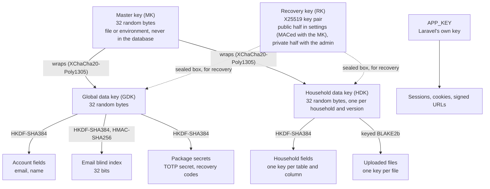

# Data security

How Abonemen protects the data it stores: which data is encrypted, with which keys and constructions, where in the code that happens, why the constructions are considered secure, and what they do not protect against. The [technical design](../product/technical-design.md#encryption-and-key-management) records the decisions; this document explains and justifies them, with references.

Status: the key hierarchy, field encryption, file encryption and log redaction are built (#18 to #24, epic #17). Backups (#85), key rotation and recovery commands (#140) and the setup wizard (#25) are designed but not built yet; they are marked *planned* below.

## Contents

1. [What is protected, and from whom](#1-what-is-protected-and-from-whom)
2. [Key hierarchy](#2-key-hierarchy)
3. [Data pipeline: where each kind of data is protected](#3-data-pipeline-where-each-kind-of-data-is-protected)
4. [Constructions and parameters](#4-constructions-and-parameters)
5. [Why this is secure](#5-why-this-is-secure)
6. [What this does not protect](#6-what-this-does-not-protect)
7. [Known gaps](#7-known-gaps)
8. [How it is tested](#8-how-it-is-tested)
9. [References](#9-references)

## 1. What is protected, and from whom

**Protected:** everything a household enters about its subscriptions and members, user names and email addresses, second-factor secrets, and uploaded files. Section 3 lists them.

**Threats in scope** (from *What this protects against* in the technical design):

| Threat | Protected? |
| --- | --- |
| A stolen disk, database file or backup | Yes: it holds ciphertext, wrapped keys and 32-bit blind indexes only |
| SQL injection or another bug that reads tables | Yes, same reason |
| Ciphertext copied between rows, columns or households | Yes: every ciphertext is bound to its row and household |
| Someone who can read logs or failed-job records | Yes: plaintext is kept out of both (section 3.7) |
| Traffic interception | Yes: TLS only, with HSTS |
| An attacker who controls the running server and its environment | **No**: the server must be able to decrypt to work |
| A curious instance operator | **No**, same reason; stated in the privacy notice |

The last two rows are the fundamental limit of server-side encryption: it protects data *at rest* and against partial compromise, not against whoever runs the server. A zero-knowledge mode, where only the browser can decrypt, is out of scope for 1.0.

## 2. Key hierarchy

| Key | What it is | Where it lives | What it protects |
| --- | --- | --- | --- |
| Master key (MK) | 32 bytes from the operating system's CSPRNG | `ABONEMEN_MASTER_KEY_FILE` (preferred) or `ABONEMEN_MASTER_KEY`. Never in the database, the config cache, logs or backups | Wraps every data key |
| Recovery key (RK) | X25519 key pair | Public half in the `settings` table, with a MAC under a key derived from the MK; private half shown once to the admin, never stored | Every data key is also sealed to it, so it alone can restore them |
| Global data key (GDK) | 32 random bytes | `data_keys`, wrapped by the MK and sealed to the RK | Account fields, the email blind index, package secrets |
| Household data key (HDK) | 32 random bytes, one per household, versioned | `data_keys`, wrapped and sealed like the GDK | That household's fields and files |
| `APP_KEY` | Laravel's key | Environment | Sessions, cookies and signed URLs only; never stored data |

This is envelope encryption: data is encrypted with data keys, data keys are encrypted (wrapped) with a key-encryption key that is stored apart from the data. OWASP's Cryptographic Storage Cheat Sheet recommends exactly this separation: keys "stored in a separate location from encrypted data", and a key-encryption key "stored separately" from the data-encryption keys it protects [OWASP-CS]. Two consequences follow:

- **Rotating the master key** only rewraps a few dozen 32-byte keys; no data is re-encrypted (*planned*, #140).
- **Deleting a household** deletes its data keys first, which makes its remaining ciphertext unreadable: cryptographic erase [NIST-88] (section 5.9).

Unwrapped keys exist only in memory for one request or job (`DataKeyRing`). The objects that hold them (`MasterKey`, `DataKeyMaterial`, `RecoverySecret`) hide their bytes from `var_dump()` and `print_r()` and refuse to be serialised, so they cannot end up in a log, a cache entry or a queued job.

**Why the master key is read from the environment at runtime, not from the config.** Laravel's `config:cache` writes every config value to `bootstrap/cache/config.php`, and anything in `config()` is visible to whatever dumps the config. `MasterKeyLoader` therefore reads the variable itself, removes it from `$_SERVER`, `$_ENV` and the request, and keeps the only copy. The file form is preferred because environment variables leak more easily: OWASP's cheat sheet advises against keeping keys in them, because of `phpinfo()` and `/proc/self/environ` [OWASP-CS].

## 3. Data pipeline: where each kind of data is protected

Each subsection follows one kind of data from the moment it enters the app to the moment it is stored, and back.

### 3.1 Household fields

Subscription name, price, currency, notes and URL; price-change amounts; member, category, tag and payment-method names; notification settings; yearly cost snapshots.

**Writing** (`App\Support\Crypto\Casts\Encrypted`, `HouseholdCipher`):

1. The value reaches the model through the request, already validated.
2. The `Encrypted` cast runs when the attribute is set. For a new row it first makes the row's ULID and takes the current household and the household's newest key version. For an existing row it uses the row's own id, household and version, and refuses to guess them if they were not loaded.
3. The household data key at that version is unwrapped with the master key (once per request).
4. CipherSweet derives the field key: HKDF-SHA384 over the HDK, with the table name as salt and a fixed domain-separation prefix plus the column name as info [RFC5869], [CS].
5. The value is encrypted with CipherSweet's BoringCrypto construction (section 4.1). The associated data is the row's ULID and household id.
6. Before saving, `HasEncryptedFields` checks that every field was encrypted for the row's final id, household and version, so a field can never be stored bound to the wrong household.
7. Only the ciphertext (`brng:` plus base64) reaches the database.

**Reading:** a field is decrypted only when its attribute is read, so listing rows needs no key. Decryption checks the MAC over the row's own id and household first; a ciphertext copied from another row, column or household fails and raises `FieldDecryptionFailed`.

**Not encrypted, on purpose:** ids, `household_id`, billing cycle, payment dates, status, reminder offsets, timestamps, roles, key versions. The scheduler needs them without decrypting. Section 6 lists what they reveal.

### 3.2 Account fields and the email blind index

User email and display name (`EncryptsAccountFields`, spatie/laravel-ciphersweet).

- **Encryption:** the same BoringCrypto construction under a field key derived from the GDK (HKDF-SHA384, table as salt, column as info). The associated data is the user's ULID.
- **Blind index:** sign-in must find a user by email without decrypting every row. CipherSweet stores a *blind index*, a keyed hash of the normalised email, in `blind_indexes` [CS-BI], [PIE-2017]:
  1. Index root key: HKDF-SHA384 over the GDK (table as salt, a domain-separation prefix plus the column as info).
  2. Index key: HMAC-SHA256 over the table, column and index name, keyed with the root key.
  3. Index value: keyed BLAKE2b over the normalised email (trimmed, Unicode NFC, lowercased), truncated to **32 bits**.
- **Lookup** (`FindUserByEmail`): compute the index, fetch the few rows that match, decrypt each and compare. Truncation causes rare false matches, and these are filtered out by decrypting. If two accounts ever share an address, neither is signed in.
- **Uniqueness:** an encrypted column cannot carry a unique index, so the `User` model checks before every save that changes an email.

The index uses CipherSweet's fast hash (keyed BLAKE2b) rather than its default slow one (Argon2id). The index key is derived from the GDK, and whoever has the GDK can decrypt the emails directly, so a slow hash would add no protection and would cost memory and time on every sign-in.

### 3.3 Second-factor secrets and other package secrets

Laravel packages that encrypt their own columns, such as Fortify's TOTP secret and recovery codes, use `GlobalEncrypter` (wired up with Fortify in #31). It is a Laravel encrypter whose key is HKDF-SHA384 over the GDK with a per-purpose info string, so each purpose has its own key. The output is the same BoringCrypto format, with the purpose as associated data. Decryption never unserialises objects.

### 3.4 Uploaded files

Logos and other uploads (`FileVault`):

1. The file key is keyed BLAKE2b-256 over `abonemen:file:{file ULID}`, keyed with the HDK, so each file has its own key [RFC7693], [LS-GH].
2. The file is encrypted with libsodium's secretstream (XChaCha20-Poly1305) in 64 KiB chunks; the last chunk carries the final tag [LS-SS].
3. It is stored as `ABF1`, the stream header, then the chunks, on the `encrypted` disk (`storage/app/encrypted`). That disk is outside the web root and not served by Laravel's `/storage` route.
4. It is served only by `GET /files/{file}`, to the file's own household, with `Cache-Control: private, no-store`, `nosniff` and `Content-Security-Policy: sandbox`.

Reading refuses a file that was altered, reordered, truncated (no final tag), extended, moved to another household or copied under another id.

### 3.5 Passwords

Passwords are not encrypted but hashed, so not even the server can recover them. The design specifies Argon2id, with bcrypt as a fallback for PHP builds without Argon2 [RFC9106]; see section 7 for the current state. Password hashes are independent of the master key.

### 3.6 Sessions, cookies and signed URLs

These use Laravel's own `APP_KEY` encrypter. Sessions are stored in the database. Losing `APP_KEY` signs everyone out but exposes no stored data, because no stored data is encrypted with it.

### 3.7 Logs, queued jobs and failures

Decrypted values exist only in memory for one request or job:

- **Queued jobs carry ids only.** An architecture test allows only id-named ints and strings, models (queued by id) and enums in a job's constructor.
- **Logs:** every log channel has a redaction tap. It replaces values under sensitive keys (password, token, email, name, price and similar) at any depth. It also scrubs every value decrypted in the current request or job from the message, the context and exceptions, whatever key it sits under.
- **Stack traces carry no arguments** (`zend.exception_ignore_args`). PHP cuts argument values to 15 characters, too short to scrub reliably.
- **Failed jobs:** Laravel stores the full exception text in `failed_jobs`; a wrapper scrubs it first.
- **Serialisation:** encrypted attributes are hidden from `toArray()` and `toJson()`, so they only reach a page or an API response when code asks for them by name.

### 3.8 Backups (*planned*, #85)

A consistent SQLite copy (`VACUUM INTO`) and the encrypted files, zipped with AES-256 under a random password per backup; the password is wrapped by the MK and sealed to the RK. The database inside is still field-encrypted, so a backup is protected twice.

## 4. Constructions and parameters

| Use | Construction | Key | Nonce or IV | Tag | Where |
| --- | --- | --- | --- | --- | --- |
| Household and account fields | CipherSweet BoringCrypto: XChaCha20 + keyed BLAKE2b-256, encrypt-then-MAC | 256-bit field key; separate encryption and MAC subkeys | 192-bit random | 256-bit | `HouseholdCipher`, `FastBoringCrypto`, spatie/laravel-ciphersweet |
| Field key derivation | HKDF-SHA384 | HDK or GDK | n/a | n/a | CipherSweet `getFieldSymmetricKey` |
| Email blind index | HKDF-SHA384, then HMAC-SHA256, then keyed BLAKE2b truncated to 32 bits | GDK | n/a | n/a | CipherSweet `BlindIndex`, fast hash |
| Wrapping data keys | XChaCha20-Poly1305 (IETF), with the key's id, owner and version as associated data | MK | 192-bit random | 128-bit | `KeyWrap` |
| Sealing data keys for recovery | libsodium sealed box: X25519 + XSalsa20-Poly1305, ephemeral sender key | RK public half | derived | 128-bit | `KeySeal` |
| Recovery key checksum | BLAKE2b-128, first 3 bytes | n/a | n/a | n/a | `RecoverySecret` |
| File key | keyed BLAKE2b-256 over the file's ULID | HDK | n/a | n/a | `FileVault` |
| File content | libsodium secretstream (XChaCha20-Poly1305), 64 KiB chunks | file key | per-stream header | 128-bit per chunk | `FileVault` |
| Package secrets | BoringCrypto format under HKDF-SHA384(GDK, purpose) | GDK-derived | 192-bit random | 256-bit | `GlobalEncrypter` |

### 4.1 CipherSweet BoringCrypto, in detail

This is the construction that protects nearly all stored fields, so here it is exactly as CipherSweet implements it (`ParagonIE\CipherSweet\Backend\BoringCrypto`). Abonemen's `FastBoringCrypto` produces the same bytes, only faster; spike 1 checked that the two read each other's output.

1. Derive two subkeys from the field key *K*: `Kenc = BLAKE2b-256(key = K, "message-encryption")` and `Kmac = BLAKE2b-256(key = K, "message-integrity")`.
2. Pick a random 24-byte nonce *N*.
3. Encrypt: `C = XChaCha20(Kenc, N) ⊕ plaintext`.
4. MAC: `T = BLAKE2b-256(key = Kmac, "brng:" ‖ N ‖ len(A) ‖ A ‖ len(C) ‖ C)`, where *A* is the associated data and the lengths are decimal strings.
5. Store `"brng:" ‖ base64url(N ‖ T ‖ C)`.

Decryption recomputes *T* and compares it in constant time before decrypting anything.

The associated data is CipherSweet's canonical form: a count of the pieces, then each piece length-prefixed. For Abonemen, that means the row and household ULIDs (household fields) or the row ULID (account fields).

## 5. Why this is secure

Each argument below rests on published properties of standard primitives. None of these constructions is new; the job is to use them as their designers intended and to bind them to the right context.

### 5.1 Fields stay confidential and cannot be changed

BoringCrypto (section 4.1) is the *encrypt-then-MAC* composition of a stream cipher and a MAC with independent keys:

- **XChaCha20 is a secure stream cipher if ChaCha20 is.** It uses HChaCha20 to derive a subkey from the key and the first 16 bytes of the nonce. The XChaCha draft argues that "as long as ChaCha20-Poly1305 is a secure AEAD cipher and ChaCha is a secure pseudorandom function (PRF), XChaCha20-Poly1305 is secure" [XCHACHA]. That rests on Bernstein's proof for the same construction on Salsa20 (XSalsa20 is secure if Salsa20 is) [DJB-XSALSA]. ChaCha20 itself is specified in RFC 8439 [RFC8439].
- **Keyed BLAKE2b is a MAC.** RFC 7693: "BLAKE2 can be directly keyed, making it functionally equivalent to a Message Authentication Code (MAC)" [RFC7693].
- **Encrypt-then-MAC is the sound composition.** With an IND-CPA-secure encryption scheme and a strongly unforgeable MAC under independent keys, it gives both confidentiality against chosen-ciphertext attacks (IND-CCA) and integrity of ciphertexts (INT-CTXT) [BN2000]. Later work refines when other compositions also work, but not this result [NRS2014].
- **Independent subkeys:** the encryption and MAC keys come from the field key through keyed BLAKE2b with different inputs.
- **Random nonces are safe at this size.** With 192-bit random nonces, the XChaCha draft estimates a 2^-32 chance of any collision only after 2^80 messages under one key [XCHACHA]. One household writes a few thousand values per year.

### 5.2 Ciphertext cannot be moved to another row, column or household

- **Columns:** each table and column has its own key (HKDF with the table as salt and the column as info), so a ciphertext moved to another column is checked against the wrong key and fails.
- **Rows and households:** the MAC covers the associated data, the row's ULID and household id. Copying a ciphertext into another row changes the associated data and the MAC check fails. This is what associated data is for in AEAD [ROG2002]. Each household also has its own HDK, so a ciphertext moved to another household fails twice over.
- **Unambiguous associated data:** CipherSweet's canonical form length-prefixes each piece, and the ULIDs always have the same length. BoringCrypto writes the lengths of *A* and *C* as unpadded decimal strings. That encoding is not injective in general, because two different (*A*, *C*) pairs of different lengths could produce the same MAC input. It cannot be exploited here: every row's associated data has the same fixed length, and an attacker who writes to the database chooses only *C*, not *A*.
- **The wrong household at write time:** `HasEncryptedFields` refuses to save a field that was encrypted for another id, household or key version than the row ends up with.

### 5.3 Keys are separated by purpose

Every derived key comes from a standard key derivation function, with a distinct context for each purpose:

- HKDF-SHA384 for field and index root keys, with the table as salt and CipherSweet's domain-separation prefixes for fields and for indexes [RFC5869], [CS].
- HMAC-SHA256 per index name.
- Keyed BLAKE2b with distinct messages for the encryption and MAC subkeys, file keys (`abonemen:file:{id}`) and the recovery checksum.

Learning one derived key reveals nothing about the key it came from or about its siblings. libsodium documents the same property for its BLAKE2b-based key derivation: "given a subkey, an attacker cannot compute the master key nor any other subkeys" [LS-KDF].

### 5.4 Wrapped data keys are bound to their row

Data keys are wrapped with XChaCha20-Poly1305. The associated data is the key's id, owner type, owner id and version, each length-prefixed so the encoding is injective. A wrapped key copied into another row, given to another household, relabelled with another version or wrapped under another master key fails to unwrap.

NIST specifies *deterministic* key-wrap modes (KW and KWP) [NIST-38F]. Rogaway and Shrimpton formalised key wrap as deterministic authenticated encryption, so that wrapping needs no nonce or random bits [RS2006]. Abonemen uses a randomized AEAD with a fresh 192-bit random nonce instead. Our reasoning: the randomized AEAD already provides confidentiality and integrity of the wrapped key and its context. It gives up determinism only, which we don't need, because the server has a CSPRNG and wraps few keys. We found no published statement that makes this argument directly, so treat it as ours.

### 5.5 Recovery needs only the recovery key, and only for the right row

A libsodium sealed box encrypts to a public key with a fresh ephemeral X25519 key pair and `crypto_box` (X25519 + XSalsa20-Poly1305). The nonce is derived from the two public keys, and the ephemeral secret key is erased right after encryption [LS-SB], [RFC7748]. So the server can make every new key recoverable without ever holding the private half.

Two properties of sealed boxes need handling:

- **A sealed box takes no associated data.** The sealed message is the same associated data as the master-key wrap followed by the key, and recovery refuses a key whose embedded associated data doesn't match its row.
- **A sealed box does not authenticate its sender.** In libsodium's words, the recipient "cannot verify the identity of the sender" [LS-SB]. Anyone who can write to the database could insert a sealed key of their own, with matching associated data, for a row they choose. A recovery would then restore the attacker's key for that row, and data written with it afterwards would be readable to them. Recovery (#140) must therefore check every recovered key against data that already exists: the GDK and each HDK must decrypt at least one existing ciphertext of theirs, and a recovered key that doesn't match its wrapped copy, where that copy can still be unwrapped, is refused. Recovery is all-or-nothing and names the first key that fails.

The public half needs protecting as well, even though it is not secret. Every new data key is sealed to it, so someone who could write to the database and swap it for a public key of their own could unseal every data key made after the swap, without ever touching the master key. The stored public half therefore carries a MAC, `crypto_auth` (HMAC-SHA512-256 [LS-AUTH]) under a key derived from the MK with keyed BLAKE2b [LS-GH], and a public half that fails it is refused before anything is sealed to it. Rotating the MK (#140) must store the public half again under the new key.

The private half is shown once as 14 groups of 4 base32 characters: the 32-byte key and a 3-byte BLAKE2b checksum. A mistyped character fails the checksum (a 2^-24 chance of passing by accident) before anything is unsealed.

### 5.6 Files cannot be altered, reordered or truncated

libsodium's secretstream guarantees that "messages cannot be truncated, removed, reordered, duplicated or modified without this being detected" [LS-SS]. Detecting truncation is the application's job: it must check that the last chunk carries the final tag, and `FileVault` does. Each file has its own key, derived from its ULID, so a file copied under another id fails. Each household has its own HDK, so a file moved to another household fails.

### 5.7 The blind index reveals little

A blind index is a keyed hash of the plaintext, kept in its own column with its own key [PIE-2017].

- **Without the GDK**, the index value is unpredictable: telling it apart from random would mean breaking keyed BLAKE2b or HMAC-SHA256. Guessing emails offline needs the key.
- **Equality leaks.** Equal emails give equal index values. Emails are unique per instance, so this reveals nothing new.
- **Truncation.** At 32 bits, CipherSweet's planning guidance aims for between 2 and √P coincidences in a population of P, so that an index value does not single out one plaintext [CS-BI]. For an instance with a few dozen users, a 32-bit index sits far below that: each value is in practice unique to one email. That is deliberate. It costs nothing in leakage beyond the equality above, and false matches stay vanishingly rare (about P/2^32 per lookup). Every match is confirmed by decrypting anyway.

### 5.8 The master key stays out of the database and the logs

- It is never written to the database, the config cache or backups.
- It never sits in an object that can be printed or serialised.
- It is removed from the server variables as the app boots.
- Without a usable master key, the app serves only a 503 page.

This follows OWASP's advice to keep keys apart from the data they protect, and to prefer files over environment variables for keys [OWASP-CS], [OWASP-KM].

### 5.9 Deleting a household destroys its data (*planned* with household deletion)

Deleting a household's data keys first makes its ciphertext unreadable even where copies remain, for example in older backups. NIST calls this cryptographic erase [NIST-88]. As OWASP notes, it only works "when all copies of the protecting keys can be destroyed" [OWASP-KM]. Backups hold the wrapped HDK too, so a deleted household is fully gone only once its last backup expires (30 days by default).

## 6. What this does not protect

**A compromised server.** Whoever controls the running app and its environment, the master key included, can decrypt everything (section 1).

**Metadata.** These are visible to anyone who can read the database:
- the number of households, users and subscriptions, and which rows belong to which household;
- billing cycles, payment dates, statuses and other plain columns;
- creation and update times (`created_at`, and the timestamp in every ULID);
- the **length** of every encrypted value: BoringCrypto is a stream cipher without padding, so a ciphertext's length gives away its plaintext's length, for example a subscription name's length or how many digits a price has. Padding values to fixed buckets would close this; it is not done yet.
- the size of every uploaded file;
- which users share an email blind index value (section 5.7).

**Memory.** PHP does not guarantee that keys and plaintext are wiped from memory once they're no longer used. A memory dump of a running process can contain them.

**Timing side channels in PHP code.** Decryption checks MACs in constant time (libsodium and `hash_equals`). Other code, such as sorting or searching decrypted values, is not constant-time.

**`APP_KEY` held in the environment.** A leaked `APP_KEY` lets someone forge session cookies and signed URLs. It does not expose stored data.

## 7. Known gaps

These differ from the design today and are tracked:

| Gap | Design | Now | Where |
| --- | --- | --- | --- |
| Password hashing | Argon2id, with a bcrypt fallback | Laravel's default (bcrypt) | Fortify and accounts, #31 |
| Session encryption | `SESSION_ENCRYPT=true` | `.env.example` and `config/session.php` default to `false` | Small fix; open an issue |
| Password reset | Tokens keyed by user id or blind index | The plaintext-email table was removed; reset isn't built yet | #31 |
| Backups | Encrypted twice (section 3.8) | Not built | #85 |
| Master and household key rotation, recovery command | Section 2 | Not built; `DataKeyRecovery` can already unseal every key | #140 |
| Setup wizard | Creates the MK, RK and GDK and shows the RK once | Not built; `abonemen:keys:generate-master` and the actions exist | #25 |
| Length hiding | Not in the design | Not done (section 6) | Proposal |

## 8. How it is tested

- **Leak test** (`tests/Feature/Crypto/EncryptionLeakTest.php`): it seeds canary values through the app's own code, then searches every byte of the SQLite file, its WAL, storage, uploads and logs for them. Plain, escaped, encoded and compressed forms all count.
- **Known-answer vectors:**
  - XChaCha20-Poly1305: the vector from the XChaCha draft, Appendix A.3.1.
  - The key-wrap format and the recovery key's display form: pinned values, each checked against an independent implementation (Python's `cryptography` and `hashlib`).
- **Tamper tests:** each layer's tests flip bits, truncate, append, swap ciphertext between rows and columns, move rows between households, change key versions, and use the wrong key.
- **Mutation checks:** for each fix to a security property, the test was confirmed to fail without the fix.
- **Architecture tests:**
  - only `App\Support\Crypto` touches cryptographic libraries;
  - every model with an encrypted field hides it and uses ULID keys;
  - jobs carry ids only.

## 9. References

| Key | Reference |
| --- | --- |
| [BN2000] | M. Bellare and C. Namprempre, "Authenticated Encryption: Relations among Notions and Analysis of the Generic Composition Paradigm", ASIACRYPT 2000 (LNCS 1976); J. Cryptology 21(4), 2008, doi:10.1007/s00145-008-9026-x. https://eprint.iacr.org/2000/025 |
| [NRS2014] | C. Namprempre, P. Rogaway and T. Shrimpton, "Reconsidering Generic Composition", EUROCRYPT 2014. https://eprint.iacr.org/2014/206 |
| [ROG2002] | P. Rogaway, "Authenticated-Encryption with Associated-Data", ACM CCS 2002, doi:10.1145/586110.586125. https://www.cs.ucdavis.edu/~rogaway/papers/ad.pdf |
| [RS2006] | P. Rogaway and T. Shrimpton, "A Provable-Security Treatment of the Key-Wrap Problem", EUROCRYPT 2006 (LNCS 4004); full version "Deterministic Authenticated-Encryption". https://eprint.iacr.org/2006/221 |
| [DJB-XSALSA] | D. J. Bernstein, "Extending the Salsa20 nonce", 2011. https://cr.yp.to/snuffle/xsalsa-20110204.pdf |
| [XCHACHA] | S. Arciszewski, "XChaCha: eXtended-nonce ChaCha and AEAD_XChaCha20_Poly1305", draft-irtf-cfrg-xchacha-03, January 2020 (expired Internet-Draft). https://datatracker.ietf.org/doc/draft-irtf-cfrg-xchacha/03/ |
| [RFC8439] | Y. Nir and A. Langley, "ChaCha20 and Poly1305 for IETF Protocols", RFC 8439, 2018. https://www.rfc-editor.org/rfc/rfc8439 |
| [RFC7748] | A. Langley, M. Hamburg and S. Turner, "Elliptic Curves for Security", RFC 7748, 2016. https://www.rfc-editor.org/rfc/rfc7748 |
| [RFC7693] | M-J. Saarinen (ed.) and J-P. Aumasson, "The BLAKE2 Cryptographic Hash and Message Authentication Code (MAC)", RFC 7693, 2015. https://www.rfc-editor.org/rfc/rfc7693 |
| [RFC5869] | H. Krawczyk and P. Eronen, "HMAC-based Extract-and-Expand Key Derivation Function (HKDF)", RFC 5869, 2010. https://www.rfc-editor.org/rfc/rfc5869 |
| [RFC9106] | A. Biryukov, D. Dinu, D. Khovratovich and S. Josefsson, "Argon2 Memory-Hard Function for Password Hashing and Proof-of-Work Applications", RFC 9106, 2021. https://www.rfc-editor.org/rfc/rfc9106 |
| [LS-SB] | libsodium documentation, "Sealed boxes". https://doc.libsodium.org/public-key_cryptography/sealed_boxes |
| [LS-SS] | libsodium documentation, "Encrypted streams and file encryption" (secretstream). https://doc.libsodium.org/secret-key_cryptography/secretstream |
| [LS-GH] | libsodium documentation, "Generic hashing" (BLAKE2b). https://doc.libsodium.org/hashing/generic_hashing |
| [LS-AUTH] | libsodium source, `crypto_auth.h`: `crypto_auth_PRIMITIVE "hmacsha512256"`. https://github.com/jedisct1/libsodium/blob/master/src/libsodium/include/sodium/crypto_auth.h |
| [LS-KDF] | libsodium documentation, "Key derivation". https://doc.libsodium.org/key_derivation |
| [CS] | Paragon Initiative Enterprises, CipherSweet (documentation and source, ISC licence). https://ciphersweet.paragonie.com, https://github.com/paragonie/ciphersweet |
| [CS-BI] | CipherSweet, "Blind Index Planning". https://ciphersweet.paragonie.com/php/blind-index-planning |
| [PIE-2017] | Paragon Initiative Enterprises, "Building Searchable Encrypted Databases with PHP and SQL", 2017. https://paragonie.com/blog/2017/05/building-searchable-encrypted-databases-with-php-and-sql |
| [NIST-38F] | M. Dworkin, "Recommendation for Block Cipher Modes of Operation: Methods for Key Wrapping", NIST SP 800-38F, 2012. https://nvlpubs.nist.gov/nistpubs/SpecialPublications/NIST.SP.800-38F.pdf |
| [NIST-88] | NIST SP 800-88 Rev. 2, "Guidelines for Media Sanitization" (cryptographic erase), 2025; supersedes Rev. 1. https://csrc.nist.gov/pubs/sp/800/88/r2/final |
| [OWASP-CS] | OWASP Cheat Sheet Series, "Cryptographic Storage Cheat Sheet". https://cheatsheetseries.owasp.org/cheatsheets/Cryptographic_Storage_Cheat_Sheet.html |
| [OWASP-KM] | OWASP Cheat Sheet Series, "Key Management Cheat Sheet". https://cheatsheetseries.owasp.org/cheatsheets/Key_Management_Cheat_Sheet.html |
